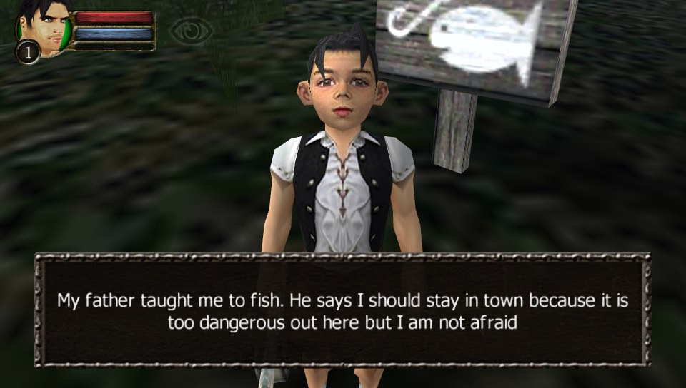
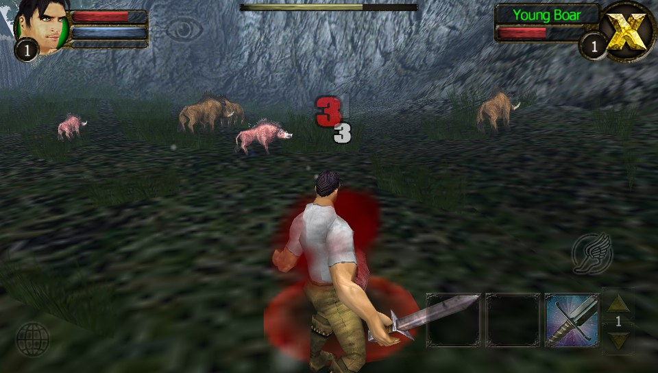
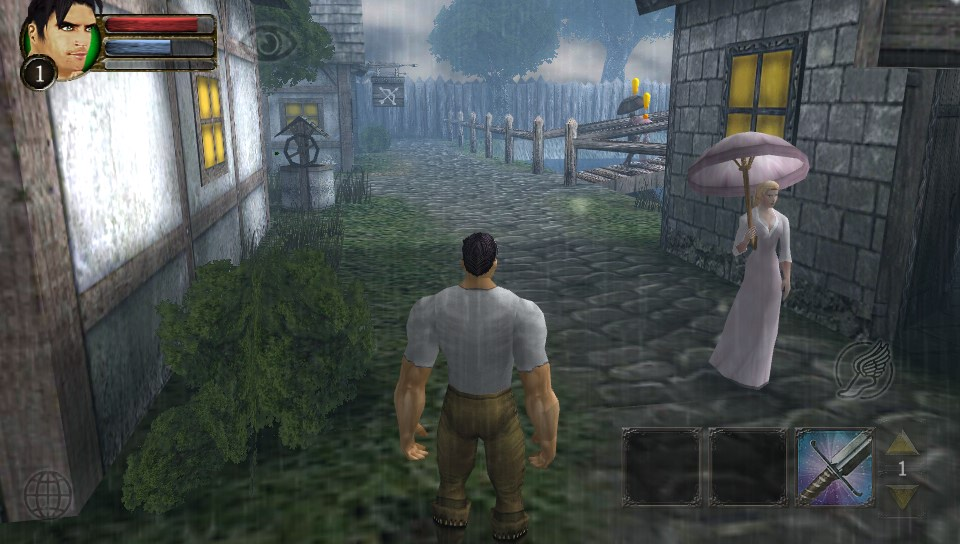
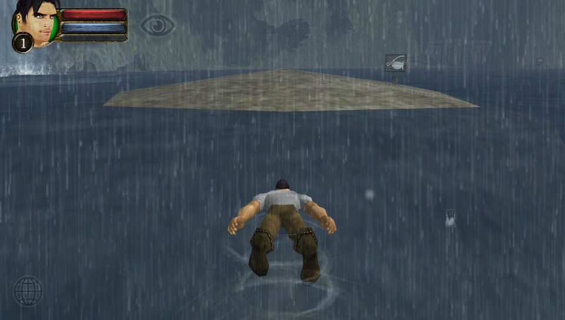

# Earth And Legend — порт для PlayStation Vita

[Русский](#russian) · [English](#english)


Порт Android-игры **Earth And Legend 3.0.0** (`com.dvidearts.earthandlegend`)
на PS Vita. Оригинальный ARMv7-код движка **ShiVa3D** (`libS3DClient.so`)
загружается через so-loader; файлов игры в репозитории нет.

**Версия порта: 1.0.0** · [Скачать VPK](https://github.com/theFilthyAnimal/EarthAndLegend-Vita/releases/latest)

<a id="russian"></a>

## Правовая информация

Все права на игру, её название, графику, звук, тексты, шрифты, движок ShiVa3D
и игровые данные принадлежат **DVide Arts** и/или правообладателям. Репозиторий
содержит только код порта, сборочные скрипты и оформление LiveArea — без APK,
`libS3DClient.so`, `S3DMain.stk`, текстур, музыки и шрифтов. Для запуска нужен
собственный APK 3.0.0. Порт не связан с DVide Arts. Лицензия MIT в
[LICENSE](LICENSE) относится только к коду порта.

## Об игре

**Earth And Legend** — 3D RPG с открытым миром от DVide Arts (Android/iOS,
начало 2010-х): свободное исследование, задания NPC, бои в реальном времени,
прокачка, оружие и броня, боевые и магические умения, инвентарь, карта, смена
дня и ночи, погода. Многопользовательский режим не работает — серверы закрыты.
Порт рассчитан только на версию **3.0.0**.

## Скриншоты

| | |
|---|---|
|  |  |
|  |  |

## Управление

| PS Vita | Действие |
|---|---|
| Левый стик | Ходьба (8 направлений) |
| Правый стик | Камера |
| Cross | Взаимодействие и умение |
| Square | Умение |
| Circle | Умение / «назад» |
| Triangle | Бег |
| L1 / R1 | Наборы умений |
| START | Инвентарь |
| SELECT | Карта |
| D-pad | Меню |

## Установка

Нужны HENkaku/ensō, VitaShell, плагин
[kubridge](https://github.com/bythos14/kubridge) и `libshacccg.suprx` в
`ur0:/data/`.

1. Установите `earthandlegend.vpk` через VitaShell.
2. Подготовьте данные игры (ниже) и скопируйте их в
   `ux0:data/earthandlegend/`.
3. Запустите игру из LiveArea.

Лог работы: `ux0:data/earthandlegend/eal.log`.

## Данные игры из APK

Нужен APK **3.0.0**. Автоматически:

```sh
python tools/prepare_data.py "Earth+And+Legend+[3.0.0].apk" earthandlegend
```

Вручную:

1. Распакуйте APK как ZIP (PowerShell: `Expand-Archive`, Linux/macOS: `unzip`).
2. Возьмите `lib/armeabi-v7a/libS3DClient.so` и `assets/S3DMain.smf`.
3. Переименуйте `S3DMain.smf` → `S3DMain.stk`.
4. Создайте рядом `cache/`, `home/`, `fonts/`, при желании добавьте
   `config.txt`.
5. Скопируйте папку в `ux0:data/earthandlegend/`.

Ориентировочные размеры: `libS3DClient.so` — 9 216 052 байт,
`S3DMain.stk` — 47 934 549 байт. Если игра не находит шрифт, положите TTF в
`fonts/`.

## config.txt

Необязательный файл в `ux0:data/earthandlegend/`. Все параметры и значения по
умолчанию описаны в [config.txt](config.txt); основные — `setting_openal`,
`setting_v3Sync`, `setting_cpuCount`, `setting_vsync`, `setting_cameraSpeed`.

## Сборка

Нужны [VitaSDK-softfp](https://github.com/vitasdk-softfp), `make`, `kubridge` на
консоли и `libshacccg.suprx`. Библиотеки уже лежат в `lib/`.

```sh
cmake -S . -B build -DCMAKE_BUILD_TYPE=Release
cmake --build build
```

Результат — `build/earthandlegend.vpk`. Для отладки используйте
`-DCMAKE_BUILD_TYPE=Debug`.

## Как устроен порт

- **so-loader:** `libS3DClient.so` загружается через `so_util`, импорты
  подменяются в `source/dynlib.c`, `kubridge` даёт RWX-память.
- **Java-слой:** точки входа `S3DRenderer` вызываются из нативного `main()`;
  `FalsoJNI` и `FalsoNDK` заменяют JavaVM и NDK, колбэки — в `source/java.c`.
- **Графика:** GLES1 транслируется в [vitaGL](https://github.com/Rinnegatamante/vitaGL)
  поверх GXM, шейдеры собирает `libshacccg`, DXT/ETC1 декодируются на CPU.
- **Звук:** собственный OpenAL-микшер (`source/reimpl/openal.c`) и вывод через
  `sceAudioOut` на 48 кГц.
- **Ввод:** кнопки и стики переводятся в Android-коды и синтетические касания
  (`source/reimpl/controls.c`).
- **Файлы:** пути Android перенаправляются в `ux0:data/earthandlegend/`,
  сохранения пишутся в `home/`.

## Использованные проекты

| Проект | Ссылка |
|---|---|
| soloader-boilerplate | https://github.com/v-atamanenko/soloader-boilerplate |
| vitaGL | https://github.com/Rinnegatamante/vitaGL |
| so_util | https://github.com/Rinnegatamante/so_util |
| kubridge | https://github.com/bythos14/kubridge |
| FalsoJNI | https://github.com/v-atamanenko/FalsoJNI |
| FalsoNDK | https://github.com/elliencode/FalsoNDK |
| SceLibcBridge | https://github.com/Rinnegatamante/SceLibcBridge |
| fios | https://github.com/TheOfficialFloW/conduit_vita |
| sha1 | https://github.com/B-Con/crypto-algorithms |
| VitaSDK-softfp | https://github.com/vitasdk-softfp |

## Лицензия

Код порта — MIT ([LICENSE](LICENSE)). Игра и её материалы принадлежат DVide
Arts и/или правообладателям.

---

<a id="english"></a>

# Earth And Legend — PlayStation Vita port

[Русский](#russian) · [English](#english)


A port of the Android game **Earth And Legend 3.0.0**
(`com.dvidearts.earthandlegend`) to the PS Vita. The original ARMv7 **ShiVa3D**
engine code (`libS3DClient.so`) is loaded through so-loader; the repository
contains no game files.

**Port version: 1.0.0** · [Download VPK](https://github.com/theFilthyAnimal/EarthAndLegend-Vita/releases/latest)

## Legal notice

All rights to the game, its name, artwork, audio, texts, fonts, the ShiVa3D
engine and the game data belong to **DVide Arts** and/or their respective
owners. This repository contains only the port's source code, build scripts and
LiveArea artwork — no APK, `libS3DClient.so`, `S3DMain.stk`, textures, music or
fonts. You need your own 3.0.0 APK to play. The port is not affiliated with
DVide Arts. The MIT license in [LICENSE](LICENSE) covers the port's code only.

## About the game

**Earth And Legend** is a 3D open-world RPG by DVide Arts (Android/iOS, early
2010s): free exploration, NPC quests, real-time combat, levelling, weapons and
armour, combat and magic skills, inventory, world map, day/night cycle and
weather. Multiplayer no longer works — the servers are gone. The port targets
version **3.0.0** only.

## Screenshots

| | |
|---|---|
|  |  |
|  |  |

## Controls

| PS Vita | Action |
|---|---|
| Left stick | Walking (8 directions) |
| Right stick | Camera |
| Cross | Interact and use a skill |
| Square | Skill |
| Circle | Skill / "back" |
| Triangle | Run |
| L1 / R1 | Skill sets |
| START | Inventory |
| SELECT | Map |
| D-pad | Menu |

## Installation

You need HENkaku/ensō, VitaShell, the
[kubridge](https://github.com/bythos14/kubridge) plugin and `libshacccg.suprx` in
`ur0:/data/`.

1. Install `earthandlegend.vpk` with VitaShell.
2. Prepare the game data (below) and copy it to `ux0:data/earthandlegend/`.
3. Launch the game from the LiveArea.

Log file: `ux0:data/earthandlegend/eal.log`.

## Game data from the APK

You need the **3.0.0** APK. Automatic:

```sh
python tools/prepare_data.py "Earth+And+Legend+[3.0.0].apk" earthandlegend
```

Manual:

1. Extract the APK as a ZIP (PowerShell: `Expand-Archive`, Linux/macOS: `unzip`).
2. Take `lib/armeabi-v7a/libS3DClient.so` and `assets/S3DMain.smf`.
3. Rename `S3DMain.smf` to `S3DMain.stk`.
4. Create `cache/`, `home/` and `fonts/` next to the files; optionally add
   `config.txt`.
5. Copy the folder to `ux0:data/earthandlegend/`.

Approximate sizes: `libS3DClient.so` — 9,216,052 bytes, `S3DMain.stk` —
47,934,549 bytes. If the game cannot find a font, put TTF files into `fonts/`.

## config.txt

Optional file in `ux0:data/earthandlegend/`. All settings and defaults are
documented in [config.txt](config.txt); the main ones are `setting_openal`,
`setting_v3Sync`, `setting_cpuCount`, `setting_vsync` and `setting_cameraSpeed`.

## Building

You need [VitaSDK-softfp](https://github.com/vitasdk-softfp), `make`, `kubridge`
on the console and `libshacccg.suprx`. The libraries are already vendored in
`lib/`.

```sh
cmake -S . -B build -DCMAKE_BUILD_TYPE=Release
cmake --build build
```

The result is `build/earthandlegend.vpk`. Use `-DCMAKE_BUILD_TYPE=Debug` for a
debug build.

## How the port works

- **so-loader:** `libS3DClient.so` is loaded by `so_util`, imports are resolved in
  `source/dynlib.c`, and `kubridge` provides RWX memory.
- **Java layer:** the `S3DRenderer` entry points are called from a native
  `main()`; `FalsoJNI` and `FalsoNDK` replace JavaVM and NDK, callbacks live in
  `source/java.c`.
- **Graphics:** GLES1 is translated to
  [vitaGL](https://github.com/Rinnegatamante/vitaGL) on top of GXM, shaders are
  built by `libshacccg`, DXT/ETC1 textures are decoded on the CPU.
- **Audio:** a custom OpenAL mixer (`source/reimpl/openal.c`) outputs through
  `sceAudioOut` at 48 kHz.
- **Input:** buttons and sticks are translated into Android key codes and
  synthetic touches (`source/reimpl/controls.c`).
- **Files:** Android paths are redirected to `ux0:data/earthandlegend/`, saves go
  to `home/`.

## Projects used

| Project | Link |
|---|---|
| soloader-boilerplate | https://github.com/v-atamanenko/soloader-boilerplate |
| vitaGL | https://github.com/Rinnegatamante/vitaGL |
| so_util | https://github.com/Rinnegatamante/so_util |
| kubridge | https://github.com/bythos14/kubridge |
| FalsoJNI | https://github.com/v-atamanenko/FalsoJNI |
| FalsoNDK | https://github.com/elliencode/FalsoNDK |
| SceLibcBridge | https://github.com/Rinnegatamante/SceLibcBridge |
| fios | https://github.com/TheOfficialFloW/conduit_vita |
| sha1 | https://github.com/B-Con/crypto-algorithms |
| VitaSDK-softfp | https://github.com/vitasdk-softfp |

## License

The port's code is MIT ([LICENSE](LICENSE)). The game and its assets belong to
DVide Arts and/or their respective owners.
